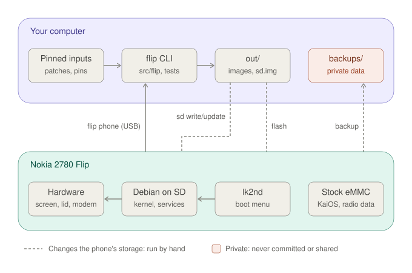
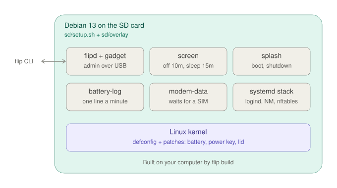

# How flip fits together

Two pictures of the system: how your computer and the phone connect, and
what runs on the phone. Command details are in the [README](../README.md).

## Your computer and the phone

- **Pinned inputs** (`pins.toml`, `patches/`, `defconfig`) are everything the
  build takes from outside, each pinned by commit or SHA-256.
- **flip CLI** (`src/flip/`, tested in `tests/`) builds, flashes, backs up and
  administers the phone. Run it as `uv run flip ...`.
- **`out/`** holds build outputs: kernel, lk2nd, the signed images and the SD
  card image. `out/sd/sd.img` contains your firmware and the phone's identity
  key, so it is private.
- **`backups/`** holds full eMMC backups, including the IMEI and radio
  calibration, which can't be recreated. Never commit or share it.

Arrows between the two:

| Arrow | Command | What it changes |
|---|---|---|
| flip phone (USB) | `flip phone run/push/pull/shell` | Files and services on the running Debian, through flipd (trusted computers only) |
| sd write/update | `flip sd write`, `flip sd update` | The whole card (write erases it) or its kernel, device tree and modules |
| flash | `flip flash ...` | lk2nd and the toolbox in the phone's boot or recovery partition (stock fastboot) |
| backup | `flip backup create` | Nothing on the phone: copies the eMMC to `backups/` through the toolbox |

The dashed ones change or copy the phone's storage: they're run by hand,
never by an agent on its own.

On the phone, **lk2nd** starts Debian from the SD card (or the toolbox, or
KaiOS: see [Booting](../README.md#booting)). **Debian** drives the
**hardware**. The **stock eMMC** keeps KaiOS and the modem's own partitions.

## What runs on the phone

Everything flip adds to Debian lives in `sd/overlay/` (programs in
`/usr/lib/flip/`, units in `/etc/systemd/system/`, settings in `/etc/flip/`)
and is enabled by `sd/setup.sh`.

| Service | Source | Job |
|---|---|---|
| flipd, flip-gadget | `usr/lib/flipd/` | The USB admin link: encrypted, trusted computers only |
| flip-screen | `usr/lib/flip/screen` | Screen off after 10 min idle, sleep after 15 (on battery), lid handling |
| flip-splash | `usr/lib/flip/splash` | Startup and shutdown animations |
| flip-battery-log | `usr/lib/flip/battery-log` | One line a minute to `/var/log/flip/battery.csv`, read by `flip battery` |
| flip-modem-data | `usr/lib/flip/modem-data` | Opens the modem's data channel for ModemManager |
| systemd stack | `etc/systemd/`, `etc/NetworkManager/`, `etc/nftables.conf` | logind (lid, power key), Wi-Fi, firewall (drops all incoming) |

The kernel is built on your computer by `flip build` from the pinned source,
`defconfig` and `patches/linux/`, and reaches the card through
`flip sd update`.
